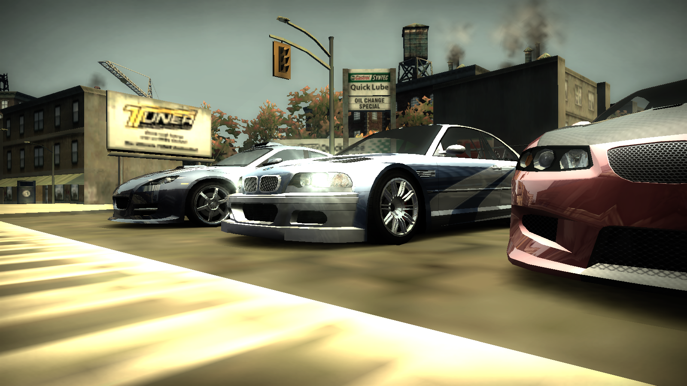
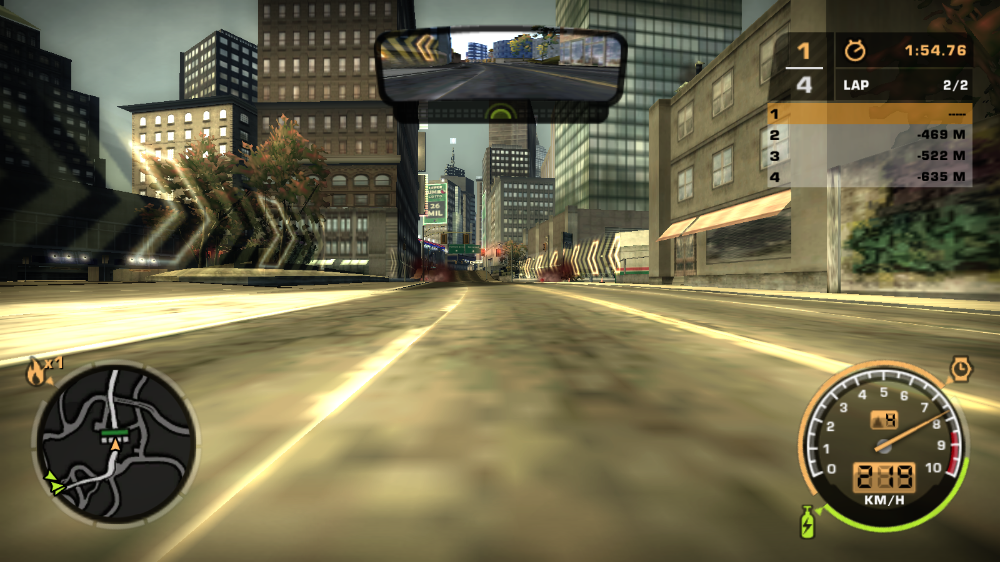

# mw-ps2-visuals
nfs most wanted visual treatment preset attempting to replicate ps2/og xbox version's visuals

## screenshots

## requirements
you've got to have these installed:

[widescreen fix](https://github.com/ThirteenAG/WidescreenFixesPack/releases/tag/nfsmw)

[extra options mod](https://github.com/ExOptsTeam/NFSMWExOpts)

## installation
just add the code snippet (in the 'use-this' file) to your -> scripts/NFSMWExtraOptionsSettings.ini

IMPORTANT: you'll need to have the `ConsoleGamma` parameter in the widescreen fix .ini set to `1`
